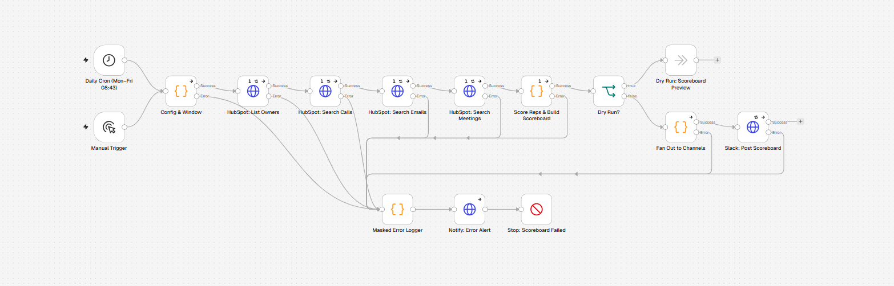

# n8n-hubspot-sales-rep-activity-quota-scoreboard

A daily sales-activity scoreboard for n8n. Every weekday morning it reads the **calls logged**, **emails sent** and **meetings booked** by each HubSpot owner over the reporting window. It scales activity quotas to the window's working days and scores each rep's weighted attainment. It then ranks the team and posts a **Slack Block Kit** scoreboard with 📞 ✉️ 📅 counts and progress bars to one or more management channels.

| File | Purpose |
|---|---|
| `workflow.json` | Importable n8n workflow: daily cron, manual trigger, config gate, HubSpot owner and activity search nodes, scoring Code node, dry-run switch, Slack broadcast, masked error branch |
| `scoreboard.js` | Config resolution, time-zone-aware windows, search bodies, activity normalisation, rep aggregation, quota scoring, ranking, Block Kit formatting, `maskSecrets()` / `maskError()` |
| `env.example` | Every environment variable, with safe placeholders |
| `LICENSE` | MIT License |
| `DISCLAIMER.md` | Liability limitation and as-is terms |

---

## Contents

- [What the scoreboard looks like](#what-the-scoreboard-looks-like)
- [Safety and privacy](#safety-and-privacy)
- [Architecture](#architecture)
- [Data sources](#data-sources)
- [Quotas, scoring and ranking](#quotas-scoring-and-ranking)
- [HubSpot Private App and scopes](#hubspot-private-app-and-scopes)
- [Slack configuration](#slack-configuration)
- [Environment variables](#environment-variables)
- [Installation](#installation)
- [Scheduling](#scheduling)
- [Using scoreboard.js outside n8n](#using-scoreboardjs-outside-n8n)
- [Editing the logic](#editing-the-logic)
- [Limitations](#limitations)

---

## What the scoreboard looks like

```
🏁 Sales activity scoreboard · Fri, Nov 13, 2026
┌───────────────────────────────┬──────────────────────────────────────────┐
│ 📞 Calls                      │ ✉️ Emails sent                            │
│ 214 (61 connected)            │ 318                                      │
│ 📅 Meetings booked            │ 🎯 Team attainment                       │
│ 17                            │ 🟡 84% · 3 on target · 1 at risk          │
└───────────────────────────────┴──────────────────────────────────────────┘
America/New_York · 1 working day · 6 reps · ranked by quota attainment
──────────────────────────────────────────────────────────────────────────
🥇 Rep O.  🟢 ▰▰▰▰▰▰▰▰▰▰ 118%
   📞 41/30 (12 connected)  ·  ✉️ 52/40  ·  📅 3/2  ·  ⭐ 106 pts
🥈 Rep T.  🟢 ▰▰▰▰▰▰▰▰▰▰ 103%
   📞 33/30 (9 connected)  ·  ✉️ 44/40  ·  📅 2/2  ·  ⭐ 83 pts
🥉 Rep F.  🟡 ▰▰▰▰▰▰▰▰▱▱ 81%
   …
 6 Rep S.  🔴 ▰▰▰▰▱▱▱▱▱▱ 42%
🟢 ≥100% · 🟡 70–99% · 🔴 <70% of quota · Targets scale with working days
```

Every rep and number above is fictional. With `DRY_RUN=true` the header starts with `[DRY RUN]` and nothing is posted.

---

## Safety and privacy

| Guardrail | Behaviour |
|---|---|
| **Read-only HubSpot access** | Only `GET /crm/v3/owners` and `POST /crm/v3/objects/{calls,emails,meetings}/search`. Nothing in HubSpot is created, changed or deleted. |
| **Dry run by default** | `DRY_RUN=true` builds the whole scoreboard (open **Score Reps & Build Scoreboard** to see `slackPayload`) and posts nothing. Only an explicit `false` turns it off; typos such as `flase` keep it on. |
| **Second guard** | **Fan Out to Channels** sits only on the `false` branch of **Dry Run?**. It also refuses to run when `SLACK_WEBHOOK_URLS` is empty (the gate rejects `DRY_RUN=false` without a webhook). |
| **Secrets stay in `$env`** | The HubSpot token and Slack webhook URLs are read by the HTTP nodes at request time. Item data only carries presence flags and a channel count, so they never appear in execution logs. |
| **PII-light output** | Slack shows a display name (`first_last_initial` by default) and counts. Owner emails are only used to match `QUOTA_OVERRIDES_JSON` and are never posted. No contact, deal, call note or email content is requested. |
| **Masked errors** | Every node's error output goes to **Masked Error Logger**. It runs `maskError()`, which applies `maskSecrets()` to strip known secret values, `Bearer`/`Basic` headers, `pat-…` tokens, Slack webhook URLs, `xox…` tokens, token query parameters, email addresses and phone numbers. The masked text is sent to `ALERT_WEBHOOK_URL` (optional), then the run stops with a masked message. |
| **Retries & rate limits** | HubSpot nodes retry 3× with 5 s backoff and wait 300 ms between pages. Slack posts are sent one per 1.1 s. |
| **Placeholders** | Any value matching `YOUR_…` counts as "not set". |

---

## Architecture



```
Daily Cron (Mon–Fri 08:43) ─┐
Manual Trigger ─────────────┴─► Config & Window  (resolveConfig, computeWindow, buildSearchBodies)
                                   │
                                   ▼
                     HubSpot: List Owners        GET  /crm/v3/owners            (paginated)
                                   ▼
                     HubSpot: Search Calls       POST /crm/v3/objects/calls/search     (paginated)
                                   ▼
                     HubSpot: Search Emails      POST /crm/v3/objects/emails/search    (paginated)
                                   ▼
                     HubSpot: Search Meetings    POST /crm/v3/objects/meetings/search  (paginated)
                                   ▼
                     Score Reps & Build Scoreboard  (buildScoreboard, buildSlackPayload)
                                   ▼
                              Dry Run? ──true──► Dry Run: Scoreboard Preview (no-op)
                                   │false
                                   ▼
                     Fan Out to Channels ─► Slack: Post Scoreboard (one item per webhook)

 any error output ─► Masked Error Logger ─► Notify: Error Alert (optional) ─► Stop: Scoreboard Failed
```

Every Code node contains the full `scoreboard.js`, preceded by a selector line:

```js
const SYNDICATOR_STAGE = 'score'; // keep this line — it selects what this node does
```

| Node | `SYNDICATOR_STAGE` | Does |
|---|---|---|
| Config & Window | `gate` | Validates env, computes the window, builds the three search bodies |
| Score Reps & Build Scoreboard | `score` | Joins owners with activities, scores, ranks, builds the Block Kit payload |
| Fan Out to Channels | `slack-items` | Emits one `{ channelIndex, slackPayload }` item per webhook |
| Masked Error Logger | `logger` | Masks the error and prepares the alert text |

The search nodes run once (`executeOnce`) and paginate with HubSpot's `paging.next.after` cursor (up to 50 pages × 200 = 10,000 records).

---

## Data sources

| Activity | Endpoint | Counted when | Window property |
|---|---|---|---|
| 📞 Calls | `POST /crm/v3/objects/calls/search` | `hubspot_owner_id` is set | `hs_timestamp` |
| 📞 Connected calls | (same records) | `hs_call_duration` ≥ `CONNECTED_CALL_MIN_SECONDS` | — |
| ✉️ Emails | `POST /crm/v3/objects/emails/search` | `hs_email_direction = EMAIL` (logged or sent by the rep, not incoming) | `hs_timestamp` |
| 📅 Meetings (booked) | `POST /crm/v3/objects/meetings/search` | created in window, outcome not cancelled | `hs_createdate` |
| 📅 Meetings (held) | (same endpoint, `MEETING_COUNT_MODE=held`) | starts in window, outcome not cancelled / no-show / rescheduled | `hs_meeting_start_time` |
| 👤 Owners | `GET /crm/v3/owners` | not archived | — |

HubSpot describes `hs_timestamp` as required, marking the call's time of creation and determining where the call sits on the record timeline. `hubspot_owner_id` is the ID of the owner associated with the call and determines the user listed as the call creator on the record timeline.

Each search filters `hs_timestamp` (or the meeting property) with `GTE` start / `LT` end in epoch milliseconds. Owners are filtered with `IN` (when `REP_OWNER_IDS` is set) or `HAS_PROPERTY`. Window boundaries are local midnights in `REPORT_TIMEZONE` converted to UTC, so daylight-saving days are 23 or 25 hours long, as expected.

| `REPORT_WINDOW` | Covers | Working days |
|---|---|---|
| `previous_business_day` (default) | The last weekday before today (Monday's run reports Friday) | 1 |
| `yesterday` | The calendar day before today | 0–1 |
| `today` | Midnight → now (in progress) | 0–1 |
| `last_week` | Previous Monday–Sunday | 5 (7 with `COUNT_WEEKENDS=true`) |
| `week_to_date` | Monday → now | 1–5 |
| `month_to_date` | 1st of the month → now | varies |

---

## Quotas, scoring and ranking

1. **Targets.** Daily targets (`DAILY_TARGET_CALLS/EMAILS/MEETINGS`) are multiplied by the window's working days. `QUOTA_OVERRIDES_JSON` replaces individual targets per rep, keyed by owner ID or owner email:
   ```json
   {"10000001": {"calls": 40}, "rep_1@example.com": {"meetings": 3}}
   ```
   A target of `0` removes that activity from the rep's attainment.
2. **Per-type attainment** = actual ÷ target, capped at `ATTAINMENT_CAP` (default 1.5). The cap stops one inflated activity from hiding a gap in another.
3. **Weighted attainment** = Σ(weight × attainment) ÷ Σ(weights of activities with a target). Default weights: calls 0.3, emails 0.2, meetings 0.5.
4. **Points** = calls × `POINTS_CALL` + connected calls × `POINTS_CONNECTED_CALL` + emails × `POINTS_EMAIL` + meetings × `POINTS_MEETING`.
5. **Rank** by `RANK_BY` (default `attainment`), then points, then total activity, then name.
6. **Status:** 🟢 ≥ 100 %, 🟡 70–99 %, 🔴 < 70 %. Progress bars have ten segments; values above 100 % show a full bar and the true percentage.

**Which reps appear:** with no filters, every owner with at least one counted activity. `REP_OWNER_IDS` and `REP_TEAM_IDS` limit the board to those owners or teams. With `INCLUDE_ZERO_ACTIVITY_REPS=true`, those reps also appear when they logged nothing. `EXCLUDE_OWNER_IDS` always wins.

---

## HubSpot Private App and scopes

Create a Private App (**Settings → Integrations → Private Apps**, or a project-based app in newer portals) and grant only these read scopes:

| Scope | Needed for |
|---|---|
| `crm.objects.owners.read` | `GET /crm/v3/owners` (rep names, teams, emails for overrides) |
| `crm.objects.contacts.read` | Calls and meetings search (HubSpot gates these engagement objects with the contacts scope) |
| `sales-email-read` | Emails search with owner and metadata visible |
| `crm.schemas.contacts.read` | Optional, only if you extend the workflow to read property definitions |

HubSpot's reference for `POST /crm/v3/objects/calls/search` lists `crm.objects.contacts.read` as the required scope, and the meetings search reference lists the same `crm.objects.contacts.read` scope. For emails, an integration needs the `sales-email-read` scope to receive the content and details of email engagements; without it, the metadata fields are redacted, and the ownerId field is also redacted. In the private-app UI, `sales-email-read` is listed under "Other" in the scope selection.

References: [Calls search](https://developers.hubspot.com/docs/api-reference/legacy/crm/activities/calls/search/search-calls), [Meetings search](https://developers.hubspot.com/docs/api-reference/legacy/crm/activities/meetings/search/search-meetings), [Engagements & `sales-email-read`](https://developers.hubspot.com/docs/api/crm/engagements).

References: [Calls search](https://developers.hubspot.com/docs/api-reference/legacy/crm/activities/calls/search/search-calls), [Meetings search](https://developers.hubspot.com/docs/api-reference/legacy/crm/activities/meetings/search/search-meetings), [Engagements & `sales-email-read`](https://developers.hubspot.com/docs/api/crm/engagements).

If the token is missing `sales-email-read`, the scoreboard either loses its emails or shows a ⚠️ note about emails without an owner. A 403 error message from the logger includes a scope hint.

Store the token as `HUBSPOT_ACCESS_TOKEN=YOUR_HUBSPOT_PRIVATE_APP_TOKEN` on the n8n host, not in the workflow.

---

## Slack configuration

1. Create a Slack app → **Incoming Webhooks** → turn on → **Add New Webhook to Workspace** → pick the management channel. Repeat for each channel.
2. Put the URLs in `SLACK_WEBHOOK_URLS`, comma-separated (max 10). Use a private test channel first.
3. Optional: a separate webhook for an ops channel in `ALERT_WEBHOOK_URL` for masked error alerts.

The payload follows Block Kit limits (≤ 50 blocks, ≤ 3,000 characters per text, header ≤ 150 characters). Two reps share each section so up to 40 reps fit. Rep names are escaped (`&`, `<`, `>`), so a name can't trigger `<!channel>`-style mentions. Link unfurling is off.

---

## Environment variables

| Variable | Default | Notes |
|---|---|---|
| `DRY_RUN` | `true` | Only `false` posts to Slack |
| `HUBSPOT_ACCESS_TOKEN` | — | Required. Private App token (secret) |
| `HUBSPOT_API_BASE` | `https://api.hubapi.com` | Must be https |
| `SLACK_WEBHOOK_URLS` | — | Required when `DRY_RUN=false` (secret) |
| `ALERT_WEBHOOK_URL` | — | Optional, masked error alerts (secret) |
| `SCOREBOARD_TITLE` | `Sales activity scoreboard` | Header text |
| `REPORT_WINDOW` | `previous_business_day` | See [Data sources](#data-sources) |
| `REPORT_TIMEZONE` | `UTC` | IANA name, e.g. `America/New_York` |
| `COUNT_WEEKENDS` | `false` | Weekends carry quota when `true` |
| `REP_OWNER_IDS` / `REP_TEAM_IDS` / `EXCLUDE_OWNER_IDS` | empty | Numeric IDs, comma-separated (≤ 100 owner IDs) |
| `INCLUDE_ZERO_ACTIVITY_REPS` | `true` | Shows filtered reps with no activity |
| `NAME_FORMAT` | `first_last_initial` | `full`, `first_last_initial` or `initials` |
| `MAX_REPS_SHOWN` | `20` | 1–40 |
| `DAILY_TARGET_CALLS` / `_EMAILS` / `_MEETINGS` | `30` / `40` / `2` | Per working day |
| `QUOTA_OVERRIDES_JSON` | empty | Per-rep daily targets |
| `WEIGHT_CALLS` / `_EMAILS` / `_MEETINGS` | `0.3` / `0.2` / `0.5` | 0–10, at least one > 0 |
| `ATTAINMENT_CAP` | `1.5` | 1–5 |
| `POINTS_CALL` / `_CONNECTED_CALL` / `_EMAIL` / `_MEETING` | `1` / `2` / `0.5` / `5` | 0–100 |
| `CONNECTED_CALL_MIN_SECONDS` | `60` | 0–3600 |
| `MEETING_COUNT_MODE` | `booked` | `booked` or `held` |
| `RANK_BY` | `attainment` | `attainment`, `points`, `meetings`, `calls`, `emails` |

Invalid values stop the run at **Config & Window** with a list of every problem. No secret values appear in that list.

---

## Installation

1. **n8n instance.** Use n8n 1.x and allow Code nodes to read environment variables:
   ```bash
   N8N_BLOCK_ENV_ACCESS_IN_NODE=false
   GENERIC_TIMEZONE=America/New_York   # the schedule's time zone
   ```
2. **Environment.** Copy `env.example`, fill in your values, and load it into the n8n container (for example `env_file:` in Docker Compose). Keep `DRY_RUN=true`. Restart n8n.
3. **Import.** In n8n: **Workflows → Import from File → `workflow.json`**.
4. **Dry run.** Click **Test workflow** on the Manual Trigger, then open **Score Reps & Build Scoreboard**. Check `scoreboard.reps` against HubSpot's activity reports for the same day, and paste `slackPayload` into [Block Kit Builder](https://app.slack.com/block-kit-builder) to preview it.
5. **Test channel.** Point `SLACK_WEBHOOK_URLS` at a private test channel, set `DRY_RUN=false`, restart, and run manually.
6. **Go live.** Add the management channel webhooks and **activate** the workflow.

---

## Scheduling

The **Daily Cron** node uses `43 8 * * 1-5` (08:43 Monday–Friday, in the workflow or instance time zone). It pairs with `REPORT_WINDOW=previous_business_day`, so Monday's run reports Friday. Common alternatives:

| Goal | Cron | `REPORT_WINDOW` |
|---|---|---|
| Morning recap of the previous business day (default) | `43 8 * * 1-5` | `previous_business_day` |
| End-of-day board | `47 17 * * 1-5` | `today` |
| Monday weekly recap | `13 9 * * 1` | `last_week` |
| Friday afternoon week-to-date | `23 15 * * 5` | `week_to_date` |

Set `REPORT_TIMEZONE` to the team's time zone so day boundaries match the sales floor, and set the workflow's time zone (**Settings → Timezone**) to match.

---

## Using scoreboard.js outside n8n

`require()` exposes the pure functions. Nothing runs on import:

```js
const sb = require('./scoreboard.js');
const { settings, errors } = sb.resolveConfig(process.env);
if (errors.length) throw new Error(errors.join('; '));
const window = sb.computeWindow(new Date(), settings);
const bodies = sb.buildSearchBodies(window, settings);      // POST these to HubSpot search
// …fetch owners and every page of each search yourself…
const board = sb.buildScoreboard({ window, owners, calls, emails, meetings }, settings);
const payload = sb.buildSlackPayload(board, settings);     // POST to a Slack webhook
console.log(sb.maskSecrets(someLogLine, [process.env.HUBSPOT_ACCESS_TOKEN]));
```

`calls`, `emails` and `meetings` are arrays of HubSpot search response pages (`{ results, paging }`). `owners` is a flat array of owner objects.

---

## Editing the logic

1. Edit `scoreboard.js`.
2. In each Code node, replace everything **below** the first `const SYNDICATOR_STAGE = …` line with the new file.
3. Keep node names unchanged; stages look up data with `$('Config & Window')`, `$('HubSpot: Search Calls')` and so on.

---

## Limitations

- HubSpot search returns at most 10,000 records per query. Very large teams on long windows should use shorter windows or `REP_OWNER_IDS` batches. The scoreboard warns when results were truncated.
- Activities logged after the run, back-dated or reassigned later are not reflected until the next run.
- "Connected" is inferred from call duration, not from `hs_call_disposition` (dispositions are portal-specific GUIDs).
- Working days ignore public holidays and leave; adjust with `QUOTA_OVERRIDES_JSON` or skip the run.
- Owners without a first or last name appear as `Owner <id>`.
- Scores are activity indicators only. They do not measure deal quality, pipeline or revenue.

---

## ⚠️ Disclaimer & Liability Limitation

**Use at your own risk.** The code, workflows, and scripts provided in this repository (`n8n-hubspot-sales-rep-activity-quota-scoreboard`) are for educational and architectural demonstration purposes.

* **No Liability:** The author and dhRobin Systems assume no responsibility or liability for any direct, indirect, incidental, or consequential damages resulting from the use, misuse, or deployment of these scripts, including compensation, performance or employment decisions based on the scoreboard.
* **No Warranty:** All software, n8n JSON blueprints, and JavaScript modules are provided "AS IS" without warranty of any kind, express or implied, including but not limited to merchantability, fitness for a particular purpose, or non-infringement. Activity counts, quota attainment, points and ranks are not guaranteed to be accurate or complete.
* **Production Testing Required:** Always test thoroughly first with `DRY_RUN=true` enabled (and, ideally, a HubSpot developer test account plus a private test Slack channel) before broadcasting to management or team channels. Treat every posted scoreboard as visible to everyone in the channel and not recallable.
* **Third-Party APIs & Compliance:** Users are solely responsible for complying with the terms of service, rate limits, data privacy regulations (GDPR/CCPA), employment and workplace-monitoring rules, and security policies of HubSpot, Slack and any connected services. That includes granting only the read scopes needed, confirming each channel's audience may see individual rep metrics, and reviewing automated scoreboards.

The full disclaimer is also available in [DISCLAIMER.md](https://github.com/dhrobinsystems/n8n-hubspot-sales-rep-activity-quota-scoreboard/blob/main/DISCLAIMER.md).

## License

Released under the MIT License. Copyright (c) 2026 DH Robin (dhRobin Systems). See [LICENSE](https://github.com/dhrobinsystems/n8n-hubspot-sales-rep-activity-quota-scoreboard/blob/main/LICENSE).

License: MIT © 2026 dhRobin Systems · Provided as-is, see the disclaimer.
